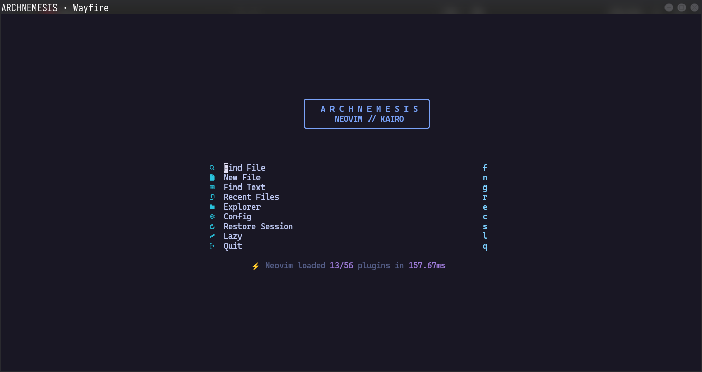
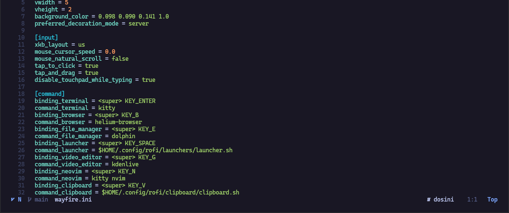

<div align="center">

# ARCHNEMESIS · Wayfire

**The same daily controls, with Wayfire’s own plugins and desktop effects.**



</div>

---

## Install

```sh
git clone git@github.com:nihitdev/wayfire-config.git ~/Projects/wayfire-config
cd ~/Projects/wayfire-config
./install.sh
```

The installer checks Arch packages and shared workflows, asks before installing or copying files, and does not create backups. `./install.sh --check` only reports requirements; `--yes` skips the installer confirmation. Helium is installed through an existing `yay` or `paru` helper when needed.

Select **Wayfire** from your display manager after installation. The installer does not start or restart the compositor and does not edit other compositor or application configs.

---

## Daily controls

| Keys | Action |
| --- | --- |
| Super+Return / B / E / Space | Kitty / Helium / Dolphin / Rofi |
| Super+G / N | Kdenlive / Kitty with Neovim |
| Super+W | Close focused window |
| Super+H/J/K and Right | Directional focus for tiled windows |
| Super+L | Toggle Simple Tile for the focused window |
| Super+M | Toggle maximize |
| Super+1…0 | Switch among ten workspaces |
| Super+Shift+1…0 | Move the focused window to a workspace and follow |
| Super+Ctrl+Alt+E / P | Expo workspaces / Scale window overview |
| Super+Ctrl+Alt+C / Super+Ctrl+Alt+Left/Right | Desktop cube / rotate cube |
| Super+Keypad 1…9 / 0 | Grid placement / restore |
| Super+Left mouse / Super+Right mouse | Move / resize windows |
| Super+V | Rofi clipboard history |
| Alt+Z or Print / Shift+Print | Region / full screenshot |
| Super+Alt+Space / Super+Alt+L | Wallpaper picker / lock |
| Volume, brightness, media keys | wpctl / brightnessctl / playerctl |

Wayfire stays floating by default. Super+L enables Simple Tile for the focused window; focus movement then uses H/J/K and Right. Expo is the workspace overview. The Waybar taskbar lists open windows because Wayfire does not provide the workspace protocol Waybar needs for workspace buttons.

---

## Wayfire features

- **Expo and Scale** for workspace and window overviews
- **Desktop cube** on a secondary binding
- **Simple Tile** as opt-in per-window tiling
- **Grid, snapping, and mouse move/resize**
- **Restrained animations, blur, rounded decorations, and wobbly windows**
- **Window placement and Wayfire-native workspace navigation**

<details>
<summary>Kitty and Wayfire configuration</summary>
<br>

</details>

---

## Existing setup requirements

This config uses your existing Rofi launcher, clipboard and themes; Waybar helper scripts; Hyprland screenshot script; Hyprlock template; battery helper; and CozyPixels wallpaper folder. The installer reports missing shared files and leaves them untouched. Those files and themes are not included in this repo.

Wayfire uses one canonical `wayfire.ini`; the remaining files are the Waybar presentation and session helper scripts. The lock script generates a Wayfire-local `hyprlock.conf` at lock time, and the wallpaper picker creates `current-wallpaper` when you choose an image. Both generated files are ignored by Git.

---

## Repository layout

```text
wayfire.ini       Wayfire configuration
waybar.jsonc      Wayfire bar modules
waybar.css        Rosé Pine styling
scripts/          Session, wallpaper, lock, and power helpers
screenshots/      Session previews
install.sh        Arch dependency check and installer
```
